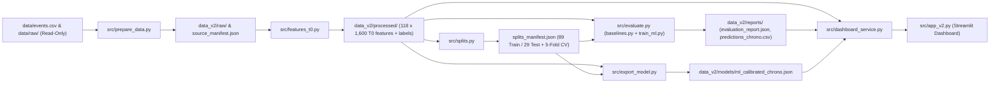

# Earthquake Aftershock Forecasting (Leak-Free Research Prototype)

An empirically evaluated, leak-free research prototype for forecasting the 30-day spatial occurrence probability of M4.0+ aftershocks following major earthquakes, built on a fixed 118-earthquake dataset while strictly separating prediction-time ($T_0$) inputs from future outcome labels.

---

## 1. Abstract & Objective

Aftershock sequences pose major secondary hazards after large earthquakes, yet machine learning models trained on post-event catalogs frequently suffer from subtle data leakage—such as estimating fault strike from future aftershocks, filtering events by future aftershock counts, or splitting spatial grid cells from the same earthquake across training and test sets.

**Objective:** Improve the scientific reliability, reproducibility, and evaluation rigor of an existing 118-earthquake aftershock forecasting prototype without downloading additional earthquakes, fabricating missing source parameters, or modifying the original dataset.

---

## 2. Project Overview & Key Capabilities

- **Fixed 118-Event Provenance:** Retains the exact 118 college-provided earthquakes (`data/events.csv`, `data/raw/`) in a verified read-only working copy (`data_v2/raw/`).
- **Strictly $T_0$-Available Features:** Removes future-aftershock strike leakage and constructs 20 prediction-time features (14 base + 6 interactions) from mainshock origin parameters only.
- **Event-Grouped Chronological Validation:** Evaluates on a strict chronological holdout (`89` earliest training events vs. `29` latest test events, zero earthquake overlap) alongside a secondary 5-fold event-grouped cross-validation across all 118 events.
- **Three Fairly Compared Models:** Benchmarks an **Isotropic Radial Baseline**, an **ETAS-Inspired Spatial Benchmark**, and a **Calibrated L2 Logistic Regression (mini-batch Adam + 3-fold OOF Platt scaling)** on identical splits, grids, and proper scoring rules.
- **Offline Reproducibility:** Serializes all 21 fitted ML weights, 20 standardizer means/stds, and Platt calibration parameters to `data_v2/models/ml_calibrated_chrono.json` (reconstructing predictions within `0.000e+00` in-memory and `5.000e-07` against 6-decimal-place CSV outputs).
- **Interactive Dashboard:** Provides a 5-tab Streamlit dashboard (`src/app_v2.py`) backed by a decoupled Python service (`src/dashboard_service.py`) without altering the original prototype (`app.py`).

---

## 3. Dataset Provenance

| Attribute | Verified Value |
|---|---|
| Candidate Query Threshold | `M7.0+` (`MIN_MAINSHOCK_MAG = 7.0`, `2000-01-01` to `2024-12-31`, USGS FDSNWS) |
| Selected Earthquakes | **118** unique events (`2000-03-28` to `2024-01-01`) |
| Realized Mainshock Magnitudes | **M7.5 – M9.1** (all 118 selected events have `mag >= 7.5`) |
| Excluded Candidates | **12** `M7.0+` raw files in `data/raw/` (`2–18` aftershocks) excluded by `MIN_AFTERSHOCKS = 20` |
| Target Window & Threshold | `(T0, T0 + 30 days]`, `M4.0+` aftershocks (`37,289` raw rows; observed `4.00–8.20`) |
| Spatial Grid | `40 × 40 = 1,600` cells per event (`188,800` total cells) over `[-E, E] × [-E, E]` km |
| Grid Coverage | **`35,555 / 37,289` (`95.35%`)** inside grid; **`1,734` (`4.65%`)** outside grid |
| Positive Cell Prevalence | **`9,905 / 188,800` (`5.2463%`)** (`13–658` positive cells/event, median `68.0`) |

---

## 4. Original Prototype vs. Improved Collaborative Implementation

| Aspect | Original Prototype (`app.py`, `features.py`, `train.py`) | Improved v2 System (`src/`, `data_v2/`) |
|---|---|---|
| Fault Strike | Estimated via PCA on future 30-day aftershocks (leakage) | Removed; strictly $T_0$-available isotropic geometry |
| Processed Data | Overwritten by `train.py` with `x, y, label, nn, base` | Immutable `data_v2/processed/` with 14 base features + labels |
| Validation Split | 5-fold `GroupKFold` only (non-chronological) | Primary chronological (`89` train / `29` test) + 5-fold grouped CV |
| Class Imbalance & Calibration | `1:3` downsampled training, uncalibrated MLP outputs | Class-weighted training + 3-fold event-grouped OOF Platt scaling |
| Baseline Score | Raw signed stress proxy `base` in `[-2, 2]` (not a probability) | Valid calibrated probabilities in `(0, 1)` for all 3 models |
| Evaluation Metrics | ROC-AUC only (often misinterpreted as accuracy) | PR-AUC, ROC-AUC, Brier, Log Loss, Hit@5%/10%/20%, 95% CIs |
| Model Persistence | Weights not saved | Serialized JSON (`data_v2/models/ml_calibrated_chrono.json`) |

---

## 5. Data Preparation & Feature Engineering

1. **Preservation & Validation (`src/prepare_data.py`):** Copies `data/events.csv` and the 118 selected `data/raw/*.csv` files into `data_v2/raw/` with SHA-256 verification, documents the 12 excluded `<20`-aftershock files in `data_v2/reports/source_manifest.json`, and checks timestamps, mainshock duplication (`0` found), and magnitude bounds (`4.00–8.20`).
2. **Grid & Label Construction (`src/features_t0.py`):** Uses an empirical Wells & Coppersmith (1994) rupture-length estimate $L = 10^{-2.44 + 0.59 M}$ (not a measured fault trace) and grid half-width $E = \max(80.0, 2.0 \cdot L)$ to define a $40 \times 40$ grid. Future 30-day aftershocks (`0 < dt <= 30` days, excluding any mainshock row) are binned strictly for ground-truth `aftershock_count` and binary `label` (`1` if `aftershock_count > 0`, else `0`).

---

## 6. All 20 $T_0$-Only Model Features

The ML model (`src/train_ml.py`) uses **14 base $T_0$ columns** (`BASE_T0_COLS`) plus **6 derived $T_0$ interaction features** (`INTERACTION_FEATURE_NAMES`). Identifiers (`event`, `cell_id`, `row_idx`, `col_idx`) and targets (`aftershock_count`, `label`) are strictly excluded.

| # | Feature Name | Definition (All Known at $T_0$) |
|---|---|---|
| 1–2 | `x`, `y` | Grid cell center East/North offsets from epicenter (km) |
| 3 | `r_km` | Radial distance $\sqrt{x^2 + y^2}$ (km) |
| 4 | `r_norm` | Normalized radial distance $r_{\text{km}} / (L / 2)$ |
| 5 | `log_r_norm` | Softened log-distance $0.5 \ln(r_{\text{norm}}^2 + 0.15)$ |
| 6 | `inv_r2` | Inverse squared distance $(r_{\text{norm}}^2 + 0.15)^{-1}$ |
| 7 | `inv_r3` | Inverse cubed distance $(r_{\text{norm}}^2 + 0.15)^{-1.5}$ |
| 8 | `mag` | Mainshock magnitude $M$ |
| 9 | `length_km` | Empirical Wells & Coppersmith (1994) rupture-length estimate $L$ |
| 10 | `extent_km` | Grid half-width $E = \max(80.0, 2.0 \cdot L)$ (km) |
| 11 | `cell_area_km2` | Area of one grid cell $(2E / 40)^2$ ($\text{km}^2$) |
| 12–14 | `lat0`, `lon0`, `abs_lat` | Mainshock latitude, longitude, and $|\text{lat}_0|$ |
| 15 | `r_norm_sq` | `r_norm * r_norm` |
| 16 | `log_r_norm_sq` | `log_r_norm * log_r_norm` |
| 17 | `mag_x_log_r_norm` | `mag * log_r_norm` |
| 18 | `mag_x_inv_r2` | `mag * inv_r2` |
| 19 | `abs_lat_x_log_r_norm` | `abs_lat * log_r_norm` |
| 20 | `cell_area_scaled_x_inv_r2` | `(cell_area_km2 / 1000.0) * inv_r2` |

---

## 7. Validation Strategy

- **Primary Chronological Split (`src/splits.py`):**
  - **Train:** Earliest `89` events (`2000-03-28` to `2016-12-08`), `142,400` cells, `7,369` positive cells (`5.1749%`), `28,196` in-grid aftershocks.
  - **Test:** Latest `29` events (`2016-12-17` to `2024-01-01`), `46,400` cells, `2,536` positive cells (`5.4655%`), `7,359` in-grid aftershocks.
- **Secondary 5-Fold Event-Grouped CV:** All `118` events partitioned into 5 interleaved event-level folds (`24, 24, 24, 23, 23` events; `0` event overlap in any fold).

---

## 8. Mathematical Explanations of the Three Models

1. **Isotropic Radial Baseline (`radial_baseline`):**
   L2-regularized logistic regression (`l2 = 1.0`, Newton-IRLS) fit on standardized $[\text{log\_r\_norm}, \text{mag}]$:
   $$P(Y_{i,c}=1) = \sigma\!\left(w_0 + w_1 \tilde{z}_{\log r} + w_2 \tilde{z}_{M}\right)$$

2. **ETAS-Inspired Spatial Benchmark (`etas_spatial_benchmark`):**
   *Not a complete space-time ETAS model* (no pre-$T_0$ background rate $\mu$ or temporal Omori decay). Models expected 30-day cell intensity $\lambda_{i,c}$ via Utsu-like magnitude scaling, a power-law spatial kernel, and scaled cell area $A_{i,c} = \text{cell\_area\_km2} / 1000$:
   $$\lambda_{i,c} = \exp\!\big(\beta_0 + \alpha (M_i - 7.5)\big) \cdot (r_{\text{norm}}^2 + d^2)^{-q} \cdot A_{i,c}, \qquad P(Y_{i,c}=1) = 1 - \exp(-\lambda_{i,c})$$
   Parameters $(\beta_0, \alpha, \log d^2, \log q)$ are fit on training events via Nelder-Mead minimizing Bernoulli log-loss (`b0=0.4772`, `alpha=-1.9221`, `d2=0.0446`, `q=0.9291`).

3. **Calibrated ML Model (`ml_calibrated`):**
   L2-regularized logistic regression (`l2 = 10.0`) over all 20 standardized $T_0$ features trained with class-balanced weights (`w_pos = n_neg / n_pos`) via mini-batch Adam (`lr=0.08`, `batch_size=8192`, `epochs=6`, `seed=42`). Raw logits $z$ are calibrated using **3-fold event-grouped out-of-fold Platt scaling** fit strictly inside the 89 training events (`a = 0.8250`, `b = -2.8907`):
   $$P(Y_{i,c}=1) = \sigma(a \cdot z_{i,c} + b)$$

---

## 9. Evaluation Results

### Chronological Holdout (29 Test Events, 46,400 Cells, 5.4655% Prevalence)

| Model | Pooled PR-AUC (95% CI) | Pooled ROC-AUC (95% CI) | Pooled Brier (95% CI) | Pooled Log Loss (95% CI) | Event Hit@5% | Event Hit@10% | Event Hit@20% |
|---|---|---|---|---|---:|---:|---:|
| `radial_baseline` | **0.3341** [0.2687, 0.3926] | **0.8497** [0.8115, 0.8815] | **0.04300** [0.03271, 0.05562] | **0.1615** [0.1263, 0.2062] | 53.97% | 68.98% | 81.11% |
| `etas_spatial_benchmark` | 0.3326 [0.2647, 0.3944] | 0.8459 [0.7990, 0.8840] | 0.04368 [0.03312, 0.05674] | 0.1648 [0.1277, 0.2116] | 53.97% | **68.99%** | 81.05% |
| `ml_calibrated` | 0.2988 [0.2256, 0.3725] | 0.8155 [0.7425, 0.8702] | 0.04441 [0.03373, 0.05855] | 0.1699 [0.1314, 0.2241] | **53.98%** | 68.92% | **81.12%** |

*(95% CIs computed via 100-resample event-cluster bootstrap. ROC-AUC measures threshold ranking discrimination, not classification accuracy.)*

### Secondary 5-Fold Event-Grouped CV (All 118 Events, 188,800 Cells)

| Model | Pooled PR-AUC | Pooled ROC-AUC | Pooled Brier | Pooled Log Loss | Event Hit@10% |
|---|---:|---:|---:|---:|---:|
| `radial_baseline` | **0.3329** | **0.8254** | **0.04135** | **0.1595** | **69.75%** |
| `etas_spatial_benchmark` | 0.3309 | 0.8205 | 0.04154 | 0.1608 | **69.75%** |
| `ml_calibrated` | 0.3221 | 0.8133 | 0.04183 | 0.1626 | 69.59% |

---

## 10. Neutral Model Comparison & Interpretation

On the chronological test set, the radial baseline and ETAS-inspired spatial benchmark achieve slightly better pooled PR-AUC and calibration scores than the calibrated ML model (`0.3341` and `0.3326` vs. `0.2988` PR-AUC; `0.04300` and `0.04368` vs. `0.04441` Brier). This indicates that the additional interaction features did not improve held-out performance in this experiment. The absence of depth and fault-plane geometry (`strike`, `dip`, `rake`) may limit the additional predictive information available to the ML model. All three models capture ~69% of in-grid aftershocks within the top 10% highest-probability cells.

---

## 11. System Architecture & Data Flow



---

## 12. Repository Folder Structure

```text
earthquake-aftershock-forecast/
├── app.py, config.py, data.py, features.py, plots.py, train.py  # Preserved original prototype
├── README 2.md                                                  # Preserved original prototype README
├── data/                                                        # Preserved original dataset (read-only)
├── docs/
│   └── Earthquake_Aftershock_Forecasting_Final_Report.md        # Formal 20-section academic report
├── src/
│   ├── config_v2.py, prepare_data.py, features_t0.py, splits.py # Stage 1–2A data & split pipeline
│   ├── math_utils.py, baselines.py, train_ml.py, evaluate.py    # Stage 2B–2D models & evaluation
│   ├── export_model.py                                          # Stage 2 JSON model serialization
│   ├── dashboard_service.py                                     # Stage 3 pure-Python backend
│   └── app_v2.py                                                # Stage 3 Streamlit dashboard
├── data_v2/
│   ├── raw/, interim/, processed/                               # Isolated working data (118 events)
│   ├── models/                                                  # ml_calibrated_chrono.json & README.md
│   └── reports/                                                 # Validation, split, & evaluation reports
├── requirements.txt                                             # UI & prototype dependencies
└── README.md                                                    # Main project documentation
```

---

## 13. Installation & Dashboard Execution

- **Stage 1–2 Pipeline & Backend Service (`src/prepare_data.py`, `features_t0.py`, `splits.py`, `evaluate.py`, `export_model.py`, `dashboard_service.py`):** Verified to run using **Python 3.9.6+ standard library only** (no external packages required).
- **Stage 3 Dashboard UI (`src/app_v2.py`):** Requires `streamlit`, `matplotlib`, and `pandas` from `requirements.txt` (plus `numpy`, `scikit-learn`, `requests` if running the original prototype).

```bash
# Install UI dependencies
pip install -r requirements.txt

# Launch the improved v2 dashboard
streamlit run src/app_v2.py
```

---

## 14. Serialized Model Reproducibility

The chronological ML model is serialized to [ml_calibrated_chrono.json](file:///Users/lakshmikanthavl/Documents/skill%20lab/earthquake-aftershock-forecast/data_v2/models/ml_calibrated_chrono.json) and can be loaded without retraining via `load_calibrated_ml()` in [train_ml.py](file:///Users/lakshmikanthavl/Documents/skill%20lab/earthquake-aftershock-forecast/src/train_ml.py):
- **Reconstructed vs. in-memory model (`46,400` test rows):** max absolute difference `0.000e+00` (`<= 1e-8`).
- **Reconstructed vs. `predictions_chrono.csv` (6-dp formatted):** max absolute difference `5.000e-07`.

---

## 15. Automated Testing Results (Stage 4)

All Stage 4 read-only automated verification checks passed across all `118` events (`188,800` cells) and `46,400` test rows:
- **Data & Model Loading:** `118` events (`89` train / `29` test), all 3 models loaded cleanly.
- **Prediction Consistency:** `max_diff_radial = 5.000e-07`, `max_diff_etas = 4.991e-07`, `max_diff_ml = 5.000e-07` (`<= 1e-6`).
- **Grid Integrity & Ranking:** `40 × 40` indices `(0,0)` to `(39,39)` verified; `0` NaN/Inf/out-of-range probabilities; Top-15 ranks strictly non-increasing; defensive `get_cell()` helper tested on boundary and invalid inputs (`ValueError`).
- **Live UI Verification:** The live Streamlit dashboard (`src/app_v2.py`) launched successfully at `http://localhost:8501/` and was manually tested across all five tabs (*Overview*, *Explorer & Forecast Map*, *Model Comparison*, *Prediction Analysis*, and *Methodology & Limitations*). Backend automated testing passed all seven categories. Fresh-machine installation and reproducibility have not been independently verified.

---

## 16. Scientific Limitations & Future Work

1. **Selection Bias ($\ge 20$ Aftershocks):** Excluding 12 `M7.0+` candidates with `< 20` aftershocks restricts evaluation to productive sequences.
2. **Grid Boundary:** Forecasts cover only `[-E, E] × [-E, E]` (`95.35%` of recorded aftershocks; `4.65%` fall outside).
3. **Missing Source Parameters:** `depth`, `strike`, `dip`, and `rake` are unavailable in `events.csv` and not fabricated.
4. **Observation-Window Coverage:** Original USGS query logs/headers were not saved; complete 30-day catalog coverage cannot be independently proven for every event (e.g., 44 events have last recorded aftershock `< 29.0` days, lowest `12.292` days for `usp000c2ka`).
5. **ETAS-Inspired Scope:** Uses a spatial triggering kernel without pre-$T_0$ background seismicity rates.
6. **Future Work:** Incorporate real-time $T_0$ focal mechanisms (GCMT/USGS), mainshock depth, and pre-$T_0$ background seismicity rates.

---

## 17. Academic Research Disclaimer

This software is an **academic research prototype** developed for educational study of spatial aftershock forecasting and machine learning methodology. It is **not** an operational earthquake forecasting system and must **not** be used for emergency response, public safety, or hazard decision-making.
